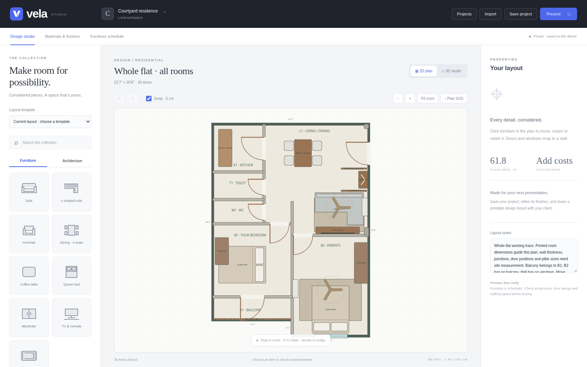

# Vela

**Thoughtful spaces. Beautifully presented.**

Vela is an interior design website built with Next.js, React, Tailwind CSS and Three.js. Its olive, ivory and champagne identity pairs self-hosted Cormorant Garamond and Manrope typography with an architectural V mark.

Production URL: https://vela-dgen.vercel.app/



## Website workflow

1. Explore the landing page, then sign up or sign in using the labelled account simulation. Guest access is also available.
2. Start an empty room in centimetres or feet and inches, or upload a PNG, JPEG, WebP or PDF floor plan. PDFs use their first page; uploaded plans are scaled tracing references, not automatic wall detection.
3. Arrange furniture, walls, doors and windows in the 2D editor and inspect the matching 3D scene. Room setup supports international currencies; inspector measurements remain in centimetres.
4. Apply finishes, record costs and suppliers, and export layout JSON, plan SVG, 3D PNG, furniture CSV or a client presentation for printing to PDF.
5. Return to the project dashboard to reopen locally saved designs.

## Account simulation and Firebase

**The default is preview mode. No backend or credentials are required.** Signup and login simulate the account flow; passwords are never checked or stored. An email identifies a local preview profile. Sessions use sessionStorage and projects use localStorage. These profiles are not secure accounts. Designs do not sync across devices, browsers or domains. Export JSON backups before clearing storage or moving domains.

Firebase Auth, Firestore and Storage adapters are prepared but disconnected in preview mode. To connect a project later:

1. Register a Firebase web app. Add the six public web configuration values listed in `.env.example` to Vercel environment settings.
2. Enable Email/Password authentication; optionally enable Google sign-in. Add `vela-dgen.vercel.app` and any custom domain to Authentication's authorized domains.
3. Create Firestore and Storage, then deploy the owner-scoped rules from `firestore.rules` and `storage.rules` using Firebase CLI (`firebase deploy --only firestore:rules,storage --project YOUR_PROJECT_ID`). Review and test rules in the emulator before a public launch.
4. Set `NEXT_PUBLIC_AUTH_MODE=firebase` and redeploy. Public configuration variables are embedded at build time. Never place service-account credentials or private keys in `NEXT_PUBLIC_` variables.

Live Firebase services have not been configured or integration-tested. Preview projects are not automatically migrated; export/import JSON when switching modes.

## Run and deploy

Use Node **24.x** and npm:

```sh
npm ci
npm run build
npm run dev
```

Development uses port 8766. `npm run start` serves the production build on port 8767. In the prepared cloud environment, use `npm ci --cache /workspace/.npm-cache --no-audit --no-fund`.

Vercel should import this repository with its root directory at the repository root. `vercel.json` selects **Next.js**, `npm ci`, `npm run build`, and explicitly sets the output directory to `.next`. This overrides the legacy `docs` project setting. If editing the Vercel dashboard settings, use `.next` or disable the output-directory override; never use `docs` for this Next.js application. No environment variables are required for the simulation. Connected Git deployments can publish subsequent pushes.

The canonical URL and sharing metadata use `https://vela-dgen.vercel.app` in `src/lib/site.js`. Brand assets are generated during preparation. Fonts are self-hosted and licensed under the SIL Open Font License; sources and palette research are in `brand/README.md`.

## Validation

```sh
npm run test:branding
# With the development server running:
npm test
# Or target the production server:
VELA_BASE_URL=http://127.0.0.1:8767 npm test
```

Browser tests require Python Playwright and Chromium. The cloud environment supplies both. Elsewhere, install Playwright and Chromium, then set `CHROMIUM_PATH` if it differs from `/usr/bin/chromium`.

Tests cover editing, drag/drop, wall attachments, undo/redo, JSON round-trip, 3D, exports, material and cost workflows, React event handling, simulation signup/login, local persistence, measured rooms, image/PDF upload, mobile widths and metadata. Firebase connectivity is intentionally not exercised in simulation mode.

## Standalone edition

`npm run build:standalone` produces `downloads/Vela.html` and `downloads/Vela.zip`. This separate offline React editor has no account or landing-page flow. Direct file opening could not be verified here because the managed browser blocks file URLs. `index.html`, `src/main.jsx` and `vite.config.js` are its source entry points; the hosted website uses `app/` and Next.js.

## Source map

- `app/`: Next.js pages and global metadata.
- `src/auth/`, `src/onboarding/`, `src/components/`: account, room setup and React workspace.
- `src/lib/`: measurements, preview stores, dormant Firebase adapters and plan upload processing.
- `planner/app.js`, `planner/studio.js`: room geometry, Three.js, project tools and exports.
- `scripts/`: branding, PDF worker preparation and standalone packaging.
- `tests/`: browser regression and asset/unit checks.

Vela preserves compatibility with Roomnote layout JSON from the original `tirthankardgen-cell/Interior-design-` repository. Furniture is schematic and dimensions should be verified on site. Budgets are manually entered estimates; currency changes relabel amounts without conversion. Tax, delivery, installation and unpriced items are excluded. Photorealistic rendering, automatic floor-plan recognition, billing and collaboration are not included.
